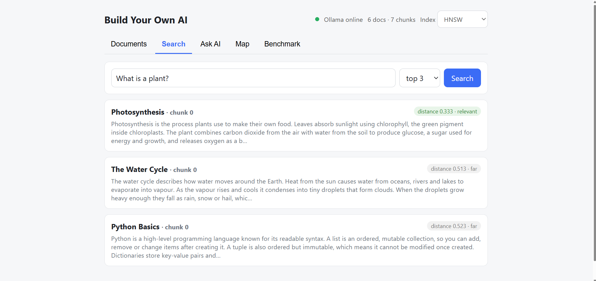
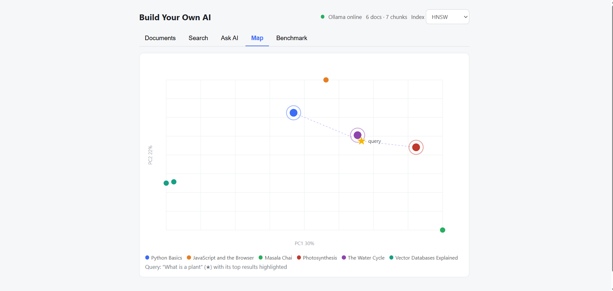
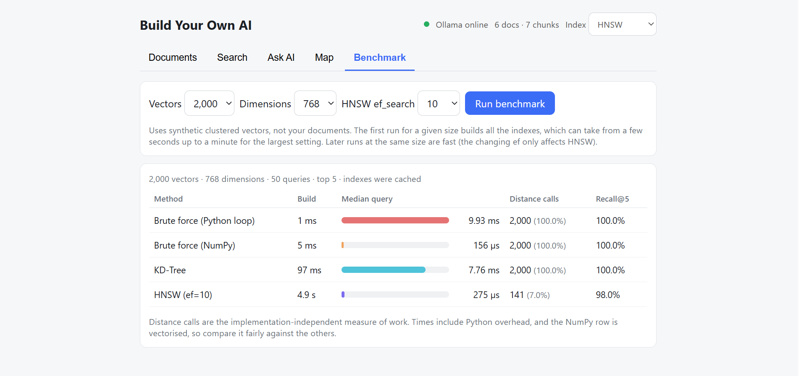
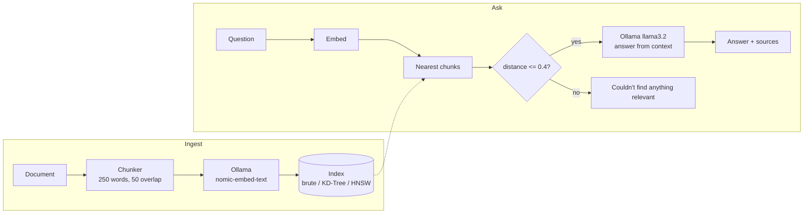

# Your Own AI

A small **vector database with a RAG chat app**, written from scratch in Python and React. Add your own documents, search them by meaning, ask questions answered from those documents, and compare three nearest-neighbour search algorithms side by side.

Everything runs locally. The language models are served by [Ollama](https://ollama.com); the chunking, distance metrics, indexes, API and UI are all written in this repository, with no vector-database library involved.

This is a Python + React rebuild of the C++ project _Your-OWN-AI_, written as a learning exercise in how systems like Pinecone, Weaviate and Chroma work under the hood.





## Features

| Tab           | What it does                                                                                                                                              |
| ------------- | --------------------------------------------------------------------------------------------------------------------------------------------------------- |
| **Documents** | Paste text or load a `.txt` / `.md` file. Documents are split into chunks, embedded and indexed. Delete any document at any time.                         |
| **Search**    | Semantic search: finds chunks by meaning, not keywords. Shows each result's cosine distance and whether it would pass the RAG relevance cutoff.           |
| **Ask AI**    | Retrieval-augmented chat. Answers come only from your documents and list their sources. If nothing relevant is found, it says so without calling the LLM. |
| **Map**       | 2D PCA scatter plot of all chunk embeddings, coloured by document. After a search, the query appears as a star with its top results highlighted.          |
| **Benchmark** | Compares brute force (Python and NumPy), KD-Tree and HNSW on synthetic data: build time, query time, distance computations and recall.                    |

The header lets you **switch the active index** (brute force, KD-Tree, HNSW) at runtime. Results stay identical for the exact methods, and HNSW is approximate but close.

## How it works



1. **Chunking.** Text is split into ~250-word chunks that overlap by 50 words, so sentences cut at a boundary keep their context.
2. **Embedding.** Each chunk becomes a 768-dimensional vector using `nomic-embed-text` through Ollama.
3. **Indexing.** Vectors go into the active index. All three indexes share one interface (`insert`, `delete`, `search`), so they are interchangeable.
4. **Retrieval.** A question is embedded the same way, and the nearest chunks by **cosine distance** are fetched (top 3 by default).
5. **Relevance cutoff.** Chunks with distance above 0.4 are dropped. If none remain, the app answers "I couldn't find anything relevant" and skips the LLM, which saves time and prevents answers from the model's general knowledge.
6. **Generation.** The surviving chunks go into a prompt that tells `llama3.2` to answer only from the context. The answer is returned with its sources.

### The three indexes

| Index           | Exact?           | Idea                                                                                                     | Notes                                                                                                                                                               |
| --------------- | ---------------- | -------------------------------------------------------------------------------------------------------- | ------------------------------------------------------------------------------------------------------------------------------------------------------------------- |
| **Brute force** | Yes              | Compare the query to every vector                                                                        | Simple, and the ground truth used to measure recall                                                                                                                 |
| **KD-Tree**     | Yes              | Split space on the highest-variance axis at the median; prune branches that can't contain a closer point | Rebuilt lazily on the first search after a change. Pruning stops working above ~10 dimensions (see findings below)                                                  |
| **HNSW**        | No (approximate) | Layered proximity graph: sparse upper layers for long hops, dense bottom layer for the final search      | Defaults: `M=16`, `ef_construction=100`, `ef_search=50`, with heuristic neighbour selection. Supports insert and delete, with repair of neighbours' links on delete |

For cosine distance the KD-Tree normalises vectors and searches by Euclidean distance (which ranks identically), and HNSW normalises on insert so a distance is just `1 - dot(a, b)`.

## Requirements

- **Python 3.10+**
- **Node.js 20+** and npm
- **[Ollama](https://ollama.com/download)** with two models:
  ```bash
  ollama pull nomic-embed-text
  ollama pull llama3.2        # or llama3.2:1b for a faster, smaller model
  ```
  About 8 GB of RAM is comfortable for `llama3.2`. To use another generation model, change `gen_model` in `ollama_client.py`.

## Quick start

Open two terminals from the project root.

**1. Backend** (terminal 1)

```powershell
cd vectordb-py
python -m venv .venv
.venv\Scripts\activate            # macOS/Linux: source .venv/bin/activate
pip install requests numpy fastapi "uvicorn[standard]"
uvicorn api:app --reload
```

The API is now at http://127.0.0.1:8000, with interactive docs at http://127.0.0.1:8000/docs.

> If PowerShell blocks the activation script, run
> `Set-ExecutionPolicy -Scope Process -ExecutionPolicy RemoteSigned` first.

**2. Sample data** (optional, in a third terminal inside `vectordb-py` with the venv active)

```powershell
python seed.py             # adds six sample documents (7 chunks) if missing
python seed.py --reset     # deletes everything first, then loads them
```

**3. Frontend** (terminal 2)

```powershell
cd ui
npm install
npm run dev
```

Open http://localhost:5173. The header shows a green dot when Ollama is reachable.

## API reference

All request and response bodies are JSON.

| Method   | Path                  | Purpose                                                                                          |
| -------- | --------------------- | ------------------------------------------------------------------------------------------------ |
| `GET`    | `/status`             | Ollama reachability, active index, document and chunk counts                                     |
| `POST`   | `/documents`          | Add a document: `{"title", "text"}` returns `{"doc_id", "title", "chunks"}`                      |
| `GET`    | `/documents`          | List documents with their chunk counts                                                           |
| `DELETE` | `/documents/{doc_id}` | Delete a document and all its chunks                                                             |
| `POST`   | `/search`             | `{"query", "k"}` returns matching chunks with `distance`                                         |
| `POST`   | `/ask`                | `{"question", "k", "max_distance"}` returns `{"answer", "sources"}`                              |
| `PUT`    | `/index`              | Switch index: `{"type": "brute" \| "kdtree" \| "hnsw"}`                                          |
| `GET`    | `/map`                | 2D PCA coordinates for every chunk, plus variance explained                                      |
| `POST`   | `/map/project`        | Project a query into the same 2D space: `{"query"}` returns `{"x", "y"}`                         |
| `POST`   | `/benchmark`          | `{"n": 1000 \| 2000 \| 5000, "dim": 8 \| 64 \| 768, "ef"}` returns per-method timings and recall |

Errors use standard codes: `400` for empty text, `404` for an unknown document, `422` for a malformed request and `503` when Ollama is unreachable.

Example:

```json
POST /ask
{ "question": "How long should I simmer the tea after adding milk?" }

{
  "answer": "About three minutes, until the tea turns a deep golden brown.",
  "sources": [{ "title": "Masala Chai", "chunk": 0, "distance": 0.21 }]
}
```

## The benchmark

The Benchmark tab runs on **synthetic clustered vectors** (20 topics with noise around each, a rough stand-in for real embeddings), not your documents, because a handful of documents would give meaningless microsecond timings. For each method it reports:

- **Build time** to index all vectors
- **Median query time** for a single query, measured on the index only (embedding time excluded)
- **Distance calls**, the average number of vector comparisons per query. This is the implementation-independent measure of work.
- **Recall@5**, the fraction of the true 5 nearest neighbours returned

It includes a **NumPy brute-force** row next to the plain Python-loop version. The loop version exaggerates how slow brute force is, and a vectorised matrix product is the fair baseline. At a few thousand vectors it is hard to beat, and HNSW's advantage appears at much larger scale, where its work grows roughly logarithmically with the number of vectors while brute force grows linearly. Indexes are cached per `(vectors, dimensions)` until the server restarts, so only the first run for a size is slow.

## Findings from building it

Numbers from the test scripts in this repo (they vary with hardware and random seeds):

**KD-Trees stop working in high dimensions.** Average distance computations per query over 5,000 random vectors (brute force always does 5,000):

| Dimensions               | 2    | 4    | 8     | 16    | 64   | 768  |
| ------------------------ | ---- | ---- | ----- | ----- | ---- | ---- |
| Share of vectors checked | 0.6% | 2.2% | 36.6% | 99.9% | 100% | 100% |

At real embedding sizes the KD-Tree degenerates into brute force, which is the curse of dimensionality and the reason HNSW exists.

**Neighbour selection matters for deletes.** After deleting 20% of 2,000 clustered vectors, plain "closest M" neighbour selection left isolated nodes and recall@5 fell to 0.86, while the heuristic selection from the HNSW paper kept it at 1.00 with no isolated nodes. Heuristic selection is the default.

**The relevance cutoff is model-specific.** The 0.4 cosine-distance threshold was tuned to `nomic-embed-text`. Good matches in the sample data sit around 0.2 to 0.3 and unrelated chunks at 0.5 or more. Long chunks sit further from short questions, so a question about a detail in a long document can need a higher cutoff (`max_distance` in `/ask`, and `max_distance` in `ui/src/api.js`).

## Project structure

```
.
├── README.md
├── vectordb-py/                 # Python backend
│   ├── api.py                   # FastAPI app and all endpoints
│   ├── document_store.py        # chunks + embeddings + index; insert, search, ask (RAG)
│   ├── ollama_client.py         # embed() and generate() over Ollama's HTTP API
│   ├── chunker.py               # word-based chunking with overlap
│   ├── distance.py              # cosine, Euclidean and Manhattan distances
│   ├── index_brute.py           # brute-force index
│   ├── index_kdtree.py          # KD-Tree index
│   ├── index_hnsw.py            # HNSW index
│   ├── index_factory.py         # builds an index by name
│   ├── projection.py            # 2D PCA for the Map tab
│   ├── benchmark.py             # synthetic benchmark behind /benchmark
│   ├── seed.py                  # loads the sample documents through the API
│   └── tests/                   # one test script per build step
└── ui/                          # React + Vite frontend
    └── src/
        ├── App.jsx              # header, index selector, tabs
        ├── api.js               # fetch wrapper for every endpoint
        ├── DocumentsTab.jsx
        ├── SearchTab.jsx
        ├── AskTab.jsx
        ├── MapTab.jsx
        └── BenchmarkTab.jsx
```

## Tests

Each build step has a plain Python script. Run them from `vectordb-py` as modules with the venv active, for example `python -m tests.test_3`.

| Script                    | Checks                                                 | Needs                               |
| ------------------------- | ------------------------------------------------------ | ----------------------------------- |
| `test_1.py`               | Ollama connection, 768-dim embeddings, text generation | Ollama                              |
| `test_2.py`               | Chunk sizes and overlap, edge cases                    | nothing                             |
| `test_3.py`               | Distance metrics and brute-force search, delete        | nothing                             |
| `test_4.py`               | Document store: insert, search, delete                 | Ollama                              |
| `test_5.py`               | RAG `ask()` including the relevance cutoff             | Ollama                              |
| `test_6.py`               | KD-Tree matches brute force; cost as dimensions grow   | Ollama (last part only)             |
| `test_7.py`, `test_7b.py` | HNSW recall, deletion, simple vs heuristic selection   | Ollama (`test_7.py` last part only) |
| `test_8.py`               | End-to-end API test through HTTP                       | API and Ollama running              |

## Limitations

- **Data lives in memory.** Restarting the server, including an automatic `--reload` restart when you save a Python file, clears all documents. Run `python seed.py` to reload the samples, or start the server without `--reload` (`uvicorn api:app`) while you are not editing code.
- **Pure Python.** The indexes favour clarity over speed. HNSW pays Python's per-step overhead, so expect a vectorised NumPy brute force to match or beat it at thousands of vectors.
- **Cosine only.** The API fixes the metric at cosine. The index classes also support Euclidean and Manhattan.
- **One request at a time.** A single lock protects the store, so a slow `/ask` (LLM generation, often 10 to 40 seconds on a CPU) blocks other document operations. Benchmarks use a separate lock.
- **Simple chunking.** Chunks split on word count, not sentence boundaries.
- **The map is approximate.** PCA squeezes 768 dimensions into 2, so points that look close may not be. Use the distances in the Search tab as the real numbers.

## Troubleshooting

| Symptom                                                | Fix                                                                                                |
| ------------------------------------------------------ | -------------------------------------------------------------------------------------------------- |
| `ollama` is not recognised                             | Install Ollama, then open a **new** terminal so the PATH update is picked up                       |
| Header says "Ollama offline"                           | Start the Ollama app, or run `ollama serve`. Check http://127.0.0.1:11434 says "Ollama is running" |
| Model not found (404)                                  | Run `ollama pull nomic-embed-text` and `ollama pull llama3.2`                                      |
| `Could not import module "api"`                        | Run `uvicorn` from inside `vectordb-py` (or add `--app-dir vectordb-py`)                           |
| UI says "Can't reach the API" while uvicorn is running | Vite probably started on another port. Add that origin to `allow_origins` in `api.py`              |
| Documents disappeared                                  | The server restarted (see Limitations). Run `python seed.py`                                       |
| A relevant question gets "couldn't find anything"      | Raise `max_distance` (try 0.5) in `ui/src/api.js`                                                  |

## Ideas for next steps

- Persist documents and embeddings to disk (for example SQLite) and rebuild the index on startup
- Stream LLM answers token by token
- Sentence-aware chunking and PDF upload
- A benchmark mode on your own stored documents
- Cross-encoder re-ranking of the retrieved chunks
