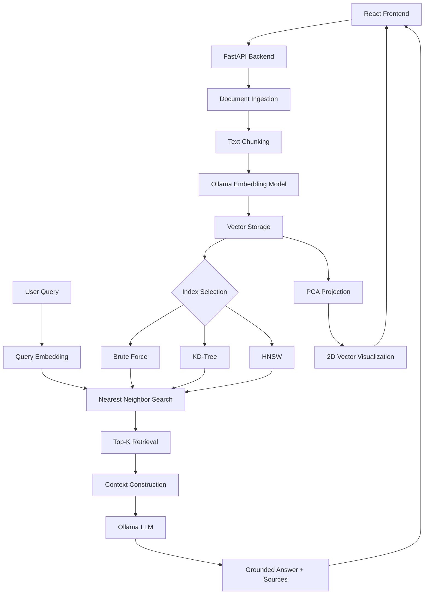

# TrainYourOwnAI 🚀

### Build, Understand & Explore Your Own Vector Database and RAG Pipeline

**TrainYourOwnAI** is a locally powered Retrieval-Augmented Generation (RAG) application built around a custom vector database implemented from scratch in Python. It transforms raw documents into semantic embeddings, indexes them using multiple search algorithms, retrieves contextually relevant information, and generates grounded answers using Large Language Models.

Instead of relying on pre-built vector database frameworks, this project implements the core mechanics of vector storage, similarity search, indexing, and retrieval to explore how modern AI-powered search systems work under the hood.

---

## ✨ Features

### 1. Document Ingestion & Processing

- Add documents through a text editor or upload `.txt` and `.md` files.
- Automatically split documents into manageable chunks.
- Implement overlapping chunking to preserve contextual continuity between adjacent chunks.
- Generate dense vector embeddings using **Ollama's `nomic-embed-text`** model.
- Maintain document-to-chunk relationships for retrieval and deletion.

### 2. Custom Vector Database

A lightweight vector database implemented from scratch, supporting three indexing strategies:

| Index       | Approach                        | Characteristics                                                                     |
| ----------- | ------------------------------- | ----------------------------------------------------------------------------------- |
| Brute Force | Exhaustive similarity search    | Evaluates every stored vector to find the nearest neighbors.                        |
| KD-Tree     | Space partitioning              | Uses a balanced tree and pruning to reduce unnecessary distance computations.       |
| HNSW        | Hierarchical graph-based search | Uses layered proximity graphs for efficient approximate nearest-neighbor retrieval. |

Additional capabilities:

- Vector insertion and deletion.
- Top-K nearest-neighbor retrieval.
- Cosine and Euclidean distance metrics.
- Pluggable indexing architecture through an index factory.
- Runtime index switching without rebuilding document embeddings.

### 3. Semantic Search

Search documents based on meaning rather than exact keyword matches.

- Convert natural-language queries into embeddings.
- Retrieve the Top-K most similar document chunks.
- Rank results by vector distance.
- Display similarity distance and relevant document context.

### 4. Retrieval-Augmented Generation (RAG)

An end-to-end RAG pipeline that connects semantic retrieval with LLM-based generation.

**Pipeline:**

1. Accept a natural-language question.
2. Generate an embedding for the query.
3. Retrieve the most relevant document chunks.
4. Filter retrieved results using a configurable distance threshold.
5. Construct a context-aware prompt using the retrieved content.
6. Pass the prompt to the LLM for response generation.
7. Return the generated answer along with source references.

The generation pipeline is designed to answer using retrieved context and explicitly acknowledge when relevant information is unavailable.

### 5. Interactive Vector Space Visualization

Explore the semantic structure of your document collection through a 2D visualization.

- Apply **Principal Component Analysis (PCA)** to high-dimensional embeddings.
- Normalize vectors before projection to preserve consistency with cosine-based retrieval.
- Project document embeddings into a two-dimensional coordinate space.
- Visualize document chunks as points, grouped by their source documents.
- Project search queries into the same vector space.
- Highlight retrieved chunks and visualize their relationship with the query.

This provides an intuitive way to understand how semantic search operates in an embedding space.

---

## 🏗️ Architecture



### Technology Stack

| Layer                    | Technologies                |
| ------------------------ | --------------------------- |
| Frontend                 | React 19, Vite, JavaScript  |
| Backend                  | Python, FastAPI, Pydantic   |
| Vector Operations        | NumPy                       |
| Embedding Model          | Ollama – `nomic-embed-text` |
| Generation Model         | Ollama – `llama3.2`         |
| Similarity Search        | Brute Force, KD-Tree, HNSW  |
| Dimensionality Reduction | PCA, NumPy SVD              |
| API Communication        | REST APIs, Fetch            |

---

## 📂 Project Structure

```text
TrainYourOwnAI/
│
├── ui/
│   ├── public/
│   └── src/
│       ├── assets/
│       ├── App.jsx
│       ├── AskTab.jsx
│       ├── DocumentsTab.jsx
│       ├── SearchTab.jsx
│       ├── MapTab.jsx
│       ├── api.js
│       ├── App.css
│       └── index.css
│
├── vectordb-py/
│   ├── tests/
│   ├── api.py
│   ├── chunker.py
│   ├── distance.py
│   ├── document_store.py
│   ├── index_brute.py
│   ├── index_factory.py
│   ├── index_hnsw.py
│   ├── index_kdtree.py
│   ├── ollama_client.py
│   └── projection.py
│
├── .gitignore
└── README.md
```

---

## ⚙️ Getting Started

### Prerequisites

Make sure you have the following installed:

- Python 3.10+
- Node.js and npm
- Ollama

### 1. Clone the repository

```bash
git clone https://github.com/Soumyad2003/Train_Your_Own_AI.git
cd TrainYourOwnAI
```

### 2. Set up Ollama

Install Ollama from [ollama.com](https://ollama.com/).

Pull the required models:

```bash
ollama pull nomic-embed-text
ollama pull llama3.2
```

Start the Ollama service.

The application expects Ollama to be accessible at:

```text
http://127.0.0.1:11434
```

### 3. Configure the Python backend

```bash
cd vectordb-py

python -m venv .venv
```

Activate the virtual environment.

**Windows PowerShell:**

```powershell
.venv\Scripts\Activate.ps1
```

**Linux / macOS:**

```bash
source .venv/bin/activate
```

Install dependencies:

```bash
pip install fastapi uvicorn requests numpy pydantic
```

Start the FastAPI server:

```bash
uvicorn api:app --reload
```

Backend API:

```text
http://127.0.0.1:8000
```

Interactive API documentation:

```text
http://127.0.0.1:8000/docs
```

### 4. Configure the frontend

Open another terminal:

```bash
cd ui
npm install
npm run dev
```

Open the application:

```text
http://localhost:5173
```

---

## 🖥️ Application Walkthrough

The application provides four interactive workspaces:

| Workspace | Functionality                                                                               |
| --------- | ------------------------------------------------------------------------------------------- |
| Documents | Upload, ingest, manage and delete documents.                                                |
| Search    | Perform semantic searches and inspect retrieved chunks.                                     |
| Ask AI    | Ask natural-language questions and receive context-grounded answers with source references. |
| Map       | Explore document embeddings and query positions in a 2D PCA space.                          |

### Using the Application

1. Start Ollama, the FastAPI backend, and the React frontend.
2. Navigate to the Documents workspace.
3. Add a document by uploading a `.txt` or `.md` file, or pasting its content.
4. Wait for the document chunks to be embedded and indexed.
5. Navigate to Search to retrieve semantically similar chunks.
6. Switch to Ask AI to ask questions about your uploaded documents.
7. Open Map to visualize the embedding space and inspect query relationships.
8. Experiment with Brute Force, KD-Tree, and HNSW indexing from the index selector.

---

## 🔌 API Reference

The backend exposes RESTful endpoints through FastAPI.

| Method | Endpoint              | Description                                                      |
| ------ | --------------------- | ---------------------------------------------------------------- |
| GET    | `/status`             | Check Ollama connectivity, active index and database statistics. |
| POST   | `/documents`          | Ingest and index a document.                                     |
| GET    | `/documents`          | Retrieve stored document metadata.                               |
| DELETE | `/documents/{doc_id}` | Delete a document and its associated vectors.                    |
| POST   | `/search`             | Perform Top-K semantic similarity search.                        |
| POST   | `/ask`                | Execute the RAG pipeline and generate an answer.                 |
| PUT    | `/index`              | Switch between indexing strategies.                              |
| GET    | `/map`                | Retrieve 2D PCA coordinates of document embeddings.              |
| POST   | `/map/project`        | Project a query embedding into the existing PCA space.           |

Complete interactive API documentation is available at `/docs`.

---

## 🧠 Engineering Concepts Explored

This project was built to understand the underlying engineering concepts behind modern AI retrieval systems.

Some of the key concepts explored include:

- **Vector Embeddings:** Representing unstructured text as dense numerical vectors.
- **Nearest Neighbor Search:** Retrieving semantically similar vectors using distance metrics.
- **Indexing & Search Optimization:** Exploring trade-offs between exhaustive search, spatial partitioning, and graph-based approximate search.
- **RAG Architecture:** Combining retrieval systems with generative models to produce context-aware responses.
- **Dimensionality Reduction:** Using PCA to visualize high-dimensional embedding spaces.
- **Modular System Design:** Separating document ingestion, storage, indexing, embedding generation, and API orchestration.
- **Concurrency Control:** Protecting shared in-memory database and index operations using synchronization.

---

## ⚠️ Current Limitations

- Documents and embeddings are stored in memory; data is not persisted across backend restarts.
- Ollama must be running and accessible for embedding generation and LLM inference.
- Document ingestion currently supports plain text and Markdown files.
- The current implementation uses a single-process backend with serialized access to shared database operations.
- HNSW provides approximate nearest-neighbor retrieval, so results may differ from exhaustive search.
- The application is currently intended for local experimentation and learning, not production workloads.

---

## 🚀 Future Improvements

- Persistent vector storage and database recovery.
- PDF and DOCX document ingestion.
- Metadata filtering and hybrid keyword-vector search.
- Streaming LLM responses.
- Benchmarking indexing strategies across different dataset sizes.
- Configurable HNSW parameters and search quality evaluation.
- Authentication, rate limiting, and production deployment support.
- Distributed ingestion and parallel embedding generation.

---

## 🎯 Motivation

The goal of this project was to go beyond using existing vector database abstractions and understand how they work internally.

By implementing multiple indexing strategies, building an end-to-end RAG pipeline, and visualizing high-dimensional embeddings, this project explores the intersection of **Data Structures & Algorithms, Backend Engineering, Information Retrieval, and Generative AI**.

**Built from scratch. Powered locally. Designed to understand AI from the inside out.**

---

⭐ If you find this project interesting, consider giving the repository a star!
